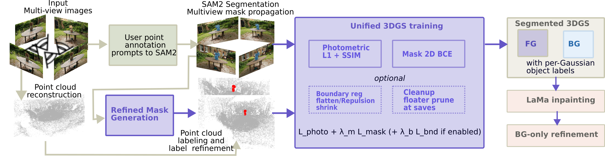

# RigidGS: Geometry-Aware Object Decoupling for Rigid-Body Interaction in 3D Gaussian Splatting

Official code for **RigidGS** (WACV 2027). Project page: `docs/index.html` (served by GitHub Pages from the `docs/` folder).

RigidGS segments objects in a 3D Gaussian Splatting scene so they can be moved,
removed or interacted with as rigid parts. Object labels come from SAM2 masks
voted onto the SfM point cloud. During training a 2D mask loss and a 3D boundary
regularizer keep each Gaussian on its own object. After training, the removed
object's hole is inpainted with LaMa and the background is refined.

<p align="center">
  
</p>

## Contents

| Path | What it is |
|---|---|
| `src/preprocessing.py` | Everything before training: SfM, SAM2 segmentation, mask refinement, point labeling, point-label refinement |
| `src/train.py` | The RigidGS trainer (Stages 1–3) |
| `eval/` | Rendering and metrics for the segmentation tables and the SPIn-NeRF removal table |
| `experiments/label_noise/` | Label-noise study (Table 4) |
| `external_overrides/` | Our changes to third-party code, copied over the pinned upstream checkouts by `scripts/setup_external.sh` |

## 1. Installation

Tested on Ubuntu with an NVIDIA RTX A6000 (48 GB), CUDA 12.9, Python 3.10, PyTorch 2.8.

```bash
git clone https://github.com/gyreyirisansah/rigidgs RigidGS && cd RigidGS
conda env create -f environment.yml
conda activate rigidgs
bash scripts/setup_external.sh
```

`setup_external.sh` does the following:

1. Clones 3D Gaussian Splatting, its CUDA rasterizer, `simple-knn` and `fused-ssim`, SAM 2, LaMa and Depth Anything V2 into `external/`, each at the exact commit we used.
2. Copies our modified files from `external_overrides/` on top of those checkouts.
3. Builds the CUDA extensions.
4. Downloads the model weights: SAM 2.1 Hiera-L, Big-LaMa and Depth Anything V2-L.

**COLMAP:** the `colmap` command-line tool must be on your `PATH`. We used COLMAP 3.14; feature extraction runs on the CPU.

## 2. Data

Put every scene under `data/<dataset>/<scene>/images/`:

```
data/
  llff/{fern,flower,fortress,horns,orchids,trex}/images/
  mipnerf360/{garden,kitchen}/images/
  innerf360/bear/images/
  tanks_and_temples/{Train,Truck}/images/
  spinnerf/{2,4,10}/            # the raw SPIn-NeRF scene folders, unchanged:
                                # images/, images_4/{label,test_label}/, sparse/0/
  ground_truth/
    images/<dataset>/<scene>/   # evaluation photos
    masks/<dataset>/<scene>/    # evaluation object masks
```

The evaluation ground truth for the segmentation tables goes in `data/ground_truth/` (TODO: download link). For SPIn-NeRF it is generated from the dataset itself:

```bash
python eval/stage_spinnerf_gt.py --scenes 2 4 10
```

## 3. Preprocessing

Run from the repository root, once per scene:

```bash
python src/preprocessing.py --images data/llff/fern/images --output output/llff/fern
```

That runs every `--mask-*` flag at its generic default, **not** this scene's paper setting --
see "Config-driven defaults" below if you want fern's actual numbers without copying them by
hand.

**Interactive step:** a window opens on one frame. Click on each object you want to segment and name it in the terminal. SAM 2 then propagates the masks to every frame.

| Step | Output under `--output` |
|---|---|
| 1. SfM (COLMAP, PINHOLE, single camera, exhaustive matching) | `sfm/sparse/0/` |
| 2. SAM 2 segmentation | `preprocessing/segmentation/masks/` |
| 3. Depth-based mask refinement | `preprocessing/refined/refined_masks/` |
| 4. 3D point labeling (multi-view voting of the raw SAM 2 masks; refined masks for Tanks and Temples) | `point_cloud/labeled_point_cloud.ply` |
| 5. Point-label refinement | `point_cloud/pcd_data/sparse/0/` ← the training input |

- **Config-driven defaults:** pass `--config configs/<dataset>/<scene>.json` and the four
  `--mask-*` flags (grid size, edge restoration, reprompt-missing-fraction, depth-quantile-high)
  and `--point-refinement`/`--knn-threshold` default to that scene's paper settings instead of
  the script's generic ones -- the same values `scripts/run_pipeline.py` uses. Any of those
  flags also given explicitly on the command line still overrides the config. `--images` and
  `--output` are filled in from the config too, so the fern example above becomes just
  `python src/preprocessing.py --config configs/llff/fern.json`. These settings only matter
  while mask refinement is actually running, i.e. you haven't also passed
  `--no-mask-refinement`.
- **Timing:** `preprocessing_timing.json` records each step's wall-clock time, including the time spent clicking (Table 7).
- **Re-running:** each step can be skipped to reuse the output it already wrote, so you can rerun from any step onward. For example, to redo mask refinement with new settings without clicking again, pass `--skip-sfm --skip-segmentation`.

  | Option | Effect |
  |---|---|
  | `--skip-sfm` | Reuse `sfm/` |
  | `--skip-segmentation` | Reuse the SAM 2 masks in `preprocessing/segmentation/` (no clicking) |
  | `--skip-mask-refinement` | No refinement this run -- whatever is already in `preprocessing/refined/` is used as-is. That can be our refined output from an earlier run, raw SAM 2 masks you copied there yourself, or masks from anywhere else; training only reads `--masks_dir`, it doesn't care where the masks came from. |
  | `--skip-labeling` | Reuse `point_cloud/labeled_point_cloud.ply` |
  | `--skip-point-refinement` | Copy the labeled points into `pcd_data` without refining their labels |

  `point_cloud/pcd_data/` is rebuilt on every run, so it always matches the current labels.
- **Point-label refinement (step 5):** `--point-refinement knn` (the default, used for the paper) relabels a point when 90% of its 40 nearest neighbours agree on a different label. `--point-refinement dbscan` first relabels scattered object points as background (DBSCAN per object), then votes within a radius; it is more aggressive, and on fern it moves about 190 frond points to background. `--skip-point-refinement` trains on the voted labels as they are.
- **No mask refinement:** for scenes where SAM 2 is already accurate, pass `--no-mask-refinement`. Training then also uses the raw SAM 2 masks.
- **SPIn-NeRF:** add `--spinnerf`:

  ```bash
  python src/preprocessing.py --spinnerf --no-mask-refinement \
    --images data/spinnerf/2/images --output output/spinnerf/2
  ```

  This does three extra things:
  - It undistorts the photos with the dataset's own calibration into `output/spinnerf/2/images_undistorted/`. Use that folder for training too.
  - It removes points seen by the 40 held-out views, so the initial point cloud cannot leak the background behind the object into the evaluation.
  - It writes the held-out list for `--eval --llffhold 0`.

  The click frame defaults to 40, because SPIn-NeRF's first 40 frames contain no object.

At the end, `preprocessing.py` prints the matching training command.

## 4. Training

```bash
python src/train.py \
  -s output/llff/fern/point_cloud/pcd_data \
  -m output/llff/fern/rigidgs \
  --_images data/llff/fern/images \
  --masks_dir output/llff/fern/preprocessing/refined/refined_masks \
  --mask_2d_bg_margin 0.5 --eval \
  --inpaint_at_iter 30000 \
  --refine_after_inpaint --refine_iterations 7000
```

`--eval` holds out every 8th view for the segmentation evaluation.

**Config-driven defaults:** add `--config configs/<dataset>/<scene>.json` and this scene's
`--mask_2d_bg_margin`, `--inpaint_at_iter`, `--refine_after_inpaint`, `--refine_iterations`,
`--mask_2d_per_object` and `--cleanup_at_saving` default to the table below instead of
`train.py`'s generic defaults; any of those also given explicitly on the command line still
wins. It does not set `-s`/`-m`/`--_images`/`--masks_dir` -- those depend on where
preprocessing wrote its output, so still pass them by hand (or use
`scripts/run_pipeline.py`, which derives them for you).

- **Stage 1 (iterations 1–30000):** trains the scene with the mask loss and the boundary regularizer. The regularizer has three loss terms: flattening, shrinkage and cross-object repulsion. Gaussians created by densification inherit their parent's fixed label, so no label ever changes.
- **Stage 2 (at iteration 30000):** asks for **one click** on the removed object's hole in a background-only render, then inpaints all views. It saves `chkpnt30000.pth` first.
- **Stage 3 (7000 iterations):** refines the background. It first adds background Gaussians in the hole, placed at a depth interpolated from the background around it. Training then alternates a full-scene step on the original photos with a background-only L1 step on the inpainted images, with the foreground frozen. During the first half, background Gaussians near the removed object are densified and pruned with Stage 1's thresholds.
- **Rerunning Stage 3:** resume from the checkpoint with `--start_checkpoint <run>/chkpnt30000.pth --skip_reinpaint`.

| Flag | Use |
|---|---|
| `--masks_dir` | `preprocessing/refined/refined_masks`, or `preprocessing/segmentation/masks` for scenes run with `--no-mask-refinement` |
| `--mask_2d_bg_margin` | Background pixels within this many pixels of the mask edge are not supervised. Per-scene values are in the table below |
| `--mask_2d_per_object` | One mask loss per object instead of foreground vs. background. Use it for scenes with several objects; for a single object it is the same loss |
| `--eval` | Hold out every 8th view (`--llffhold 8`) for evaluation |
| `--eval --llffhold 0` | SPIn-NeRF: hold out instead the 40 views listed by preprocessing |
| `--cleanup_at_saving` | Optional floater prune, off by default (see below). Used only for LERF figurines |

**Optional floater prune (`--cleanup_at_saving`).** At the final save of each stage (iteration 30000 and the end of Stage 3), it removes foreground Gaussians that densification has carried away from their own object. For each object, a Gaussian is pruned if its distance to its 8th-nearest Gaussian of the same object is more than `--cleanup_floater_distance_ratio` (default 4) times that object's median, and its opacity is below `--cleanup_floater_max_opacity` (default 0.5). Background Gaussians are never pruned and no label is changed. All results in the paper's tables are without it.

**Speed vs. memory:** the boundary regularizer's neighbour search uses a CPU kD-tree, but the work after it (boundary normals and cross-object pairs) now runs as GPU tensor operations rather than Python loops. That cut its per-call time from 417 ms to 71 ms in our measurement, at the cost of some extra GPU memory. The output is identical to the loop version. `training_cost.json` in each run folder records wall-clock time, CPU time and peak GPU memory for each stage.

### Per-scene settings

Three groups of settings were chosen per scene:

- **Mask refinement** (`preprocessing.py`): `--mask-grid-size`, `--mask-edge-restoration`, `--mask-reprompt-missing-fraction` and `--mask-depth-quantile-high`. A larger grid thresholds depth in smaller cells, which removes background trapped between thin parts (the gaps between fern fronds) but can cut into compact objects.
- **Point labels** (`preprocessing.py`): which masks vote the 3D point labels. Tanks and Temples scenes (an `--images` path under `tnt/`, `tandt/` or `tanks*/`) use the refined masks automatically; every other scene uses the raw SAM 2 masks. `--label-with-refined-masks` and `--label-with-sam2-masks` override this. See [Which masks label the points](#which-masks-label-the-points) below the table.
- **Mask-loss margin** (`train.py --mask_2d_bg_margin`). With margins below 1 pixel, nothing is excluded.

| Dataset | Scene | Masks | Grid | Edge restoration | Missing fraction | Depth quantile high | Point labels | `--mask_2d_bg_margin` |
|---|---|---|---|---|---|---|---|---|
| LLFF | fern | refined | 4 | yes | 0.15 | 98.0 | SAM 2 | 0.5 |
| LLFF | orchids | refined | 4 | yes | 0.15 | 98.0 | SAM 2 | 1 |
| LLFF | flower | refined | 1 | | 0.10 | 99.99 | SAM 2 | 1 |
| LLFF | fortress, horns | refined | 1 | | 0.10 | 99.99 | SAM 2 | 3 |
| LLFF | trex | refined | 1 | | 0.10 | 99.99 | SAM 2 | 15 |
| Mip-NeRF 360 | garden | refined | 1 | | 0.10 | 99.99 | SAM 2 | 15 |
| Mip-NeRF 360 | kitchen | refined | 1 | | 0.10 | 99.99 | SAM 2 | 3 |
| IN2N | bear | refined | 1 | | 0.10 | 99.99 | SAM 2 | 3 |
| Tanks and Temples | Train | refined | 1 | | 0.10 | 99.99 | refined | 10 |
| Tanks and Temples | Truck | refined | 4 | yes | 0.10 | 99.99 | refined | 12 |
| SPIn-NeRF | 2, 4, 10 | SAM 2 (`--no-mask-refinement`) | – | – | – | – | SAM 2 | 1 |

#### Which masks label the points

Mask refinement changes the SAM 2 masks in two ways:

- **It adds missed parts.** On large objects, SAM 2 can leave out whole regions (parts of Truck and Train). Refinement adds them back.
- **It removes background caught between thin parts.** SAM 2 merges the gaps between fern fronds into the object. Refinement cuts them out, but it also trims the fronds' thin edges.

When refinement runs, training uses the refined masks for the mask loss. For labeling the 3D points, the trimming hurts: SfM points sit mostly on textured edges and thin tips. On fern, voting with the refined masks labels about 20% of the fern's points as background. Labels stay fixed during training, so those frond fragments remain in the background render.

So label with the raw SAM 2 masks (the default) for small objects and thin structures, and with the refined masks for large objects that SAM 2 under-segments (the default for Tanks and Temples; elsewhere add `--label-with-refined-masks`). The *Point labels* column gives the setting used for each scene in the paper.

Blank cells and 0.10 / 99.99 are the defaults. Mask refinement is tuned for full-resolution photos; run it on the original images, not downscaled copies.

For example, fern:

```bash
python src/preprocessing.py --images data/llff/fern/images --output output/llff/fern \
  --mask-grid-size 4 --mask-edge-restoration \
  --mask-reprompt-missing-fraction 0.15 --mask-depth-quantile-high 98.0
```

or equivalently, letting `--config` fill in this table's row for you:

```bash
python src/preprocessing.py --config configs/llff/fern.json
```

To redo only the mask refinement and everything after it, add `--skip-sfm --skip-segmentation`; the existing SfM model and SAM 2 masks are kept.

## 5. Reproducing per-scene paper numbers

`scripts/run_pipeline.py` chains preprocessing, training and evaluation for one or more scenes using the settings in `configs/<dataset>/<scene>.json` (the same per-scene settings as the table in Section 4), and compares the result against each config's `"paper"` field:

```bash
python scripts/run_pipeline.py --scenes llff/fern llff/trex --gpus 0,1,2 --dry_run   # preview the commands
python scripts/run_pipeline.py --scenes all --gpus 0,1,2 \
    --gt_root data/ground_truth/images --gt_mask_root data/ground_truth/masks
```

Preprocessing is interactive (Section 3) and runs one scene at a time in this terminal; once a scene is preprocessed, training and evaluation move to a free GPU while you label the next scene.

**A note on exact reproducibility.** RigidGS is built around a user pointing at the object(s) they want to segment in their own capture, rather than a fixed, benchmark-style object definition — that's the point of an interactive, application-facing method. The paper's per-scene numbers come from one particular set of SAM 2 click prompts. Re-running `run_pipeline.py` from raw photos re-prompts SAM 2 from scratch, so the resulting masks — and everything trained on them — are not guaranteed to be bit-identical to the paper's run. For objects with thin or intricate geometry (LLFF `trex`, `orchids`, `flower` — see each config's `notes.prompt_sensitivity`), getting close to the paper's masks typically takes a few corrective clicks rather than a single one, so results can vary a bit between runs and between users. Treat each config's `"paper"` numbers as the target to land near, not a bit-for-bit pass/fail check. For an exact rerun of masks/labels you already have, skip the interactive step with `--skip-segmentation`/`--skip-labeling` (Section 3).

## 6. Evaluation

### Segmentation (Tables 1–2, Supplementary Table 1)

Render the held-out views at iteration 30000 (the end of Stage 1; Stage 3 changes only the background), with foreground and background separated. Then collect them and score:

```bash
python eval/render_fg_bg.py -m output/llff/fern/rigidgs --iteration 30000 --skip_train
python eval/collect_renders.py -m output/llff/fern/rigidgs \
  --results_root output/eval_renders --method RigidGS --dataset llff --scene fern
# ... repeat for every scene ...
python eval/evaluate_segmentation.py \
  --results_root output/eval_renders \
  --gt_root data/ground_truth/images --gt_mask_root data/ground_truth/masks \
  --output_dir output/eval
```

This writes `per_view.csv`, `per_scene.csv` and `per_dataset.csv` (IoU, boundary IoU, accuracy, …). Each ground-truth mask is matched to the render whose camera content is closest to the mask's frame. That matching is decoupled from the metric being reported.

### Object removal on SPIn-NeRF (Table 5)

Train each SPIn-NeRF scene with `--eval --llffhold 0` and `--_images output/spinnerf/<scene>/images_undistorted`, then:

```bash
python eval/run_spinnerf_eval.py --scenes 2 4 10
```

This renders the 40 held-out views and reports PSNR, SSIM, LPIPS and FID inside the object's bounding box. Results are written to `output/spinnerf/eval_results.json`.

### Ablation (Table 3)

Every variant uses the training command above. Only these flags change:

| Variant | Flags |
|---|---|
| Initialization only | `--mask_2d_weight 0 --boundary_reg_weight 0` |
| + 2D mask loss | `--boundary_reg_weight 0` |
| Full RigidGS | (none) |
| Full + learnable labels | `--learnable_logits --logit_freeze_iter 15000` |

### Label noise (Table 4)

```bash
python experiments/label_noise/run_label_noise_matrix.py \
  --scenes llff:fern,llff:trex,mipnerf360:kitchen,mipnerf360:garden --gpus 0 \
  --mask_2d_bg_margin_map "llff:fern=0.5,llff:trex=0.5,mipnerf360:kitchen=5,mipnerf360:garden=5"
bash experiments/label_noise/evaluate.sh
```

This corrupts a fraction of the initial point labels (background→foreground, foreground→background, and both, at 10/20/30 %). It retrains each scene and evaluates segmentation. To produce the mechanism plot (Sec. 4.6), add `--extra_trainer_args "--enable_mechanism_trace ..."`, then run `experiments/label_noise/plot_mechanism_trace.py`.

### Compute cost (Table 7)

- **Preprocessing:** `output/<dataset>/<scene>/preprocessing_timing.json` (clicks, segmentation, mask refinement, labeling).
- **Training:** `<run>/training_cost.json` (per stage: wall-clock time, peak GPU memory, and inpainting / depth-prior / refinement times).
- **Optional:** `eval/extract_training_metrics.py` summarises the TensorBoard logs.

## Acknowledgements and licenses

RigidGS's own code is released under the non-commercial research license in [LICENSE.md](LICENSE.md).

RigidGS builds on [3D Gaussian Splatting](https://github.com/graphdeco-inria/gaussian-splatting) (Inria, non-commercial research license, which also covers our modified copies in `external_overrides/gaussian-splatting` and `eval/render_fg_bg.py`), [SAM 2](https://github.com/facebookresearch/sam2), [LaMa](https://github.com/advimman/lama), [Depth Anything V2](https://github.com/DepthAnything/Depth-Anything-V2) and [COLMAP](https://colmap.github.io/) -- each under its own license in its `external/` directory. Note that while Depth Anything V2's base code is Apache-licensed, its larger pretrained checkpoints are distributed separately under CC BY-NC 4.0.

## Citation

```bibtex
TODO
```
